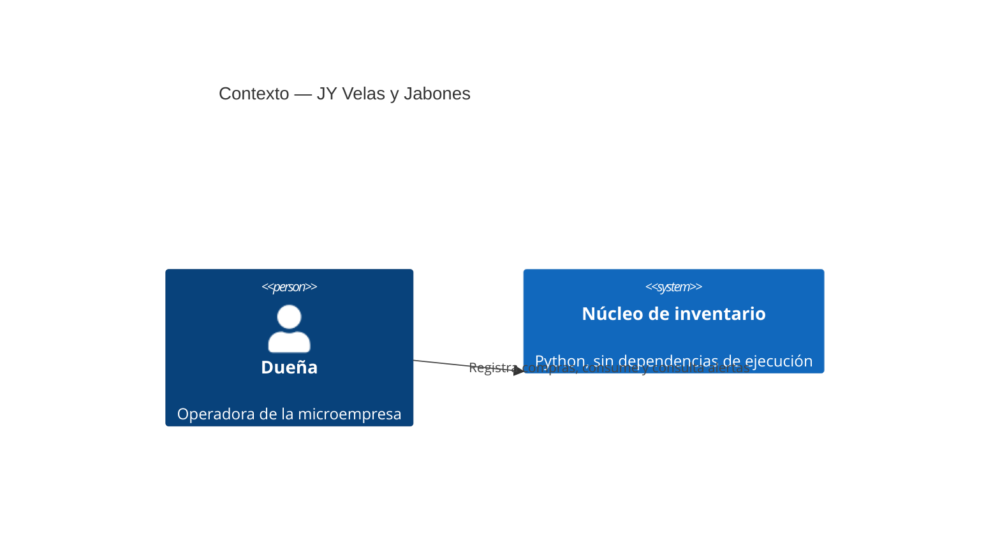
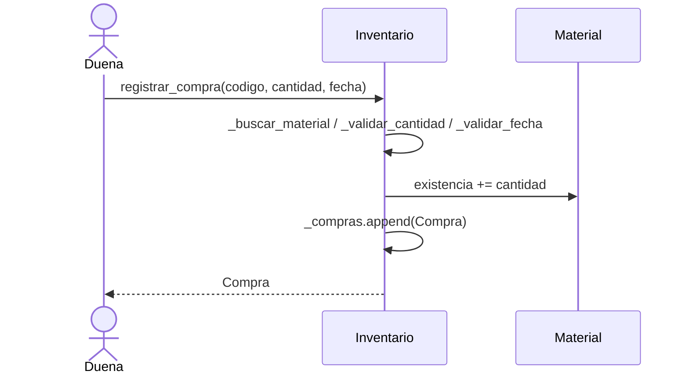

# Diseño del sistema (Módulo 3)

## Contexto (C4 nivel 1)

## Contenedores (C4 nivel 2)

| Contenedor | Tecnología | Responsabilidad |
|---|---|---|
| `jy_velas/inventario.py` | Python 3.11 | Catálogo, compras, consumos y alertas |
| `tests/` | pytest 9.2.0 | Verificación de reglas de negocio y abuso |
| Cliente (futuro) | Web/móvil | Interfaz; consume el mismo contrato |

## Secuencia de una compra

## Modelo de datos (9 entidades)

`Material`, `Compra`, `Consumo`, `Producto`, `Receta`, `Pedido`, `ItemPedido`, `Venta`, `Cliente`.
En el incremento actual solo `Material` y `Compra` están implementadas en código; el resto queda
modelado para las siguientes iteraciones.

## Contrato interno (13 operaciones previstas)

`registrar_compra`, `existencia`, `historial`, `consumir_material`, `materiales_bajo_minimo`
(implementadas) y ocho operaciones de pedidos, ventas y reportes diferidas.

## Decisiones arquitectónicas

Ver [`adr.md`](adr.md). Resumen: biblioteca estándar en el núcleo, datos en memoria, consumo
separado del historial de compras y cantidades finitas.

## Evidencia

- [`../jy_velas/inventario.py`](../jy_velas/inventario.py): implementación del contrato.
- Informe de diseño de la semana 4 (diagramas C4, secuencia y ER completos).
